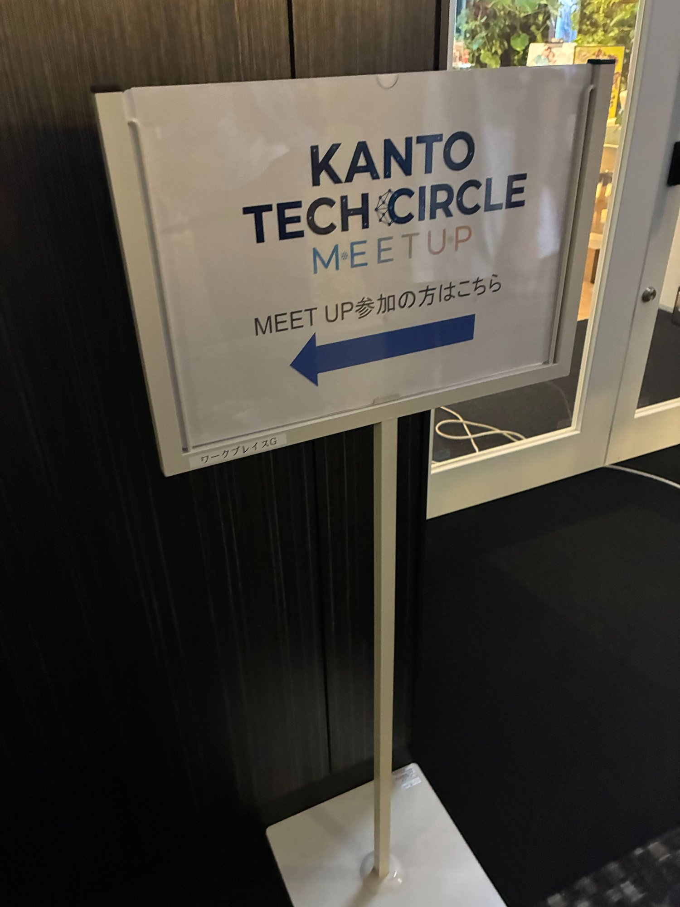
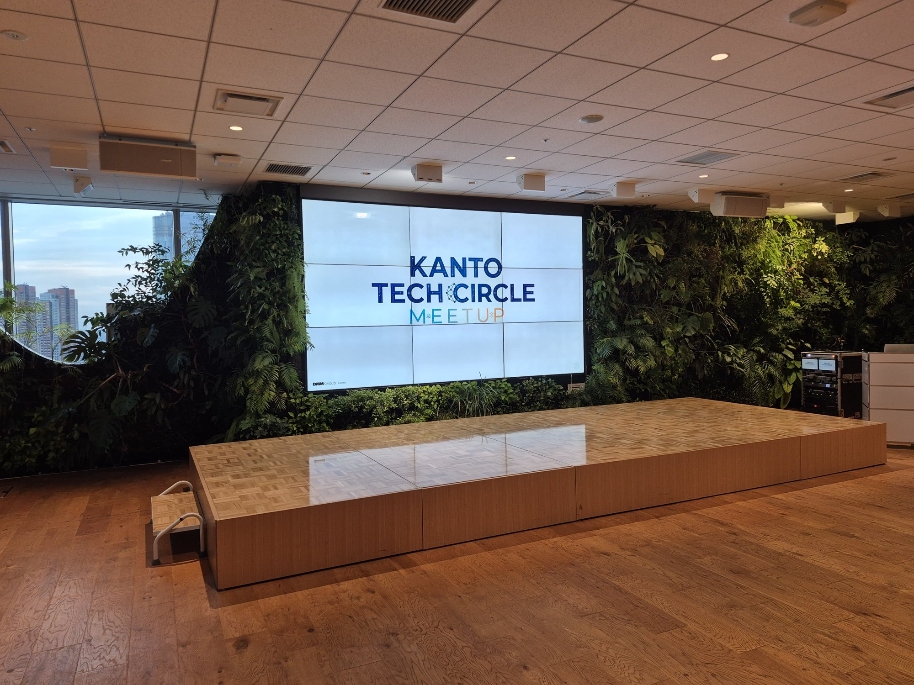
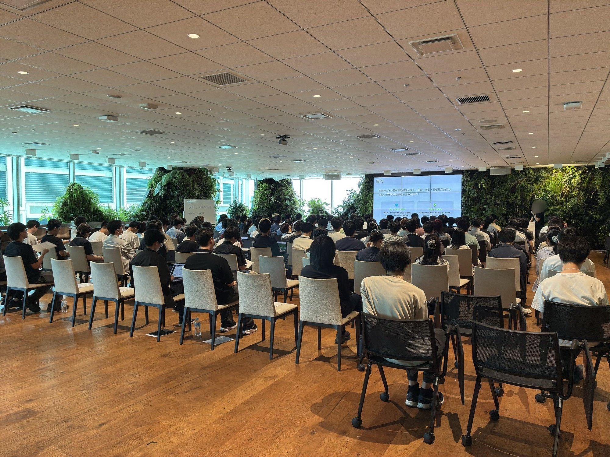
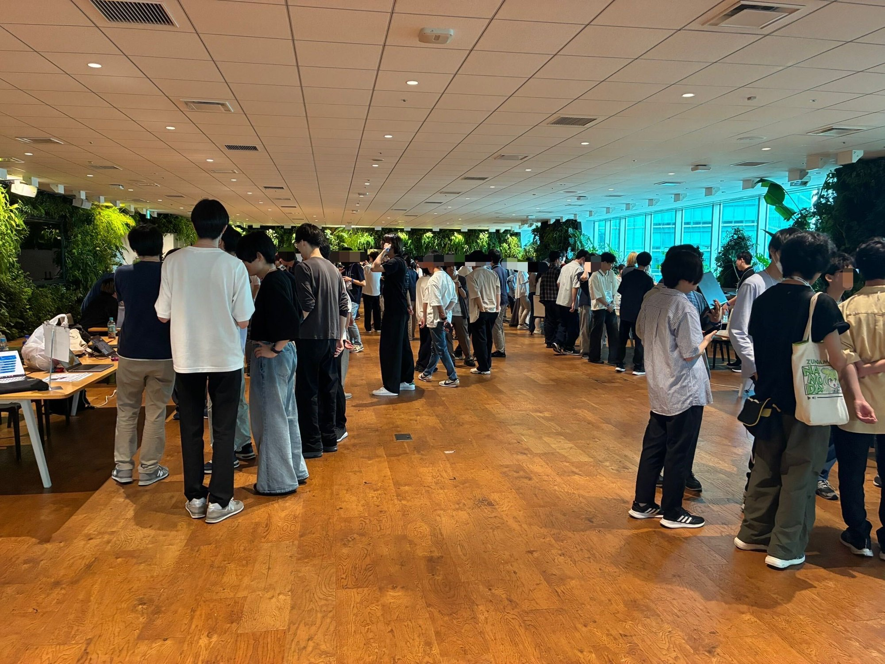

こんにちは。電気通信大学の技術系サークル MMA で、昨年度まで部長をしていた ka.kii です。

[:contents]

## はじめに

今年の前半までにやったことを振り返ろうということで、おそらく私史上最大規模の企画を行った話を書き残しておこうと思います。

2026年7月11日（土）、六本木のDMM.com様のオフィスにて「Kanto Tech Circle Meetup」を開催しました。

- **日時**: 2026/7/11（土）
- **場所**: DMM.com様オフィス（六本木）
- **対象**: 関東の技術系学生団体に所属している学生
- **人数**: だいたい140人くらい
- **目的**:
    - 関東の学生団体がつながる場を作り、盛り上げに寄与する
    - 学生が主催することで、1年生でも参加しやすい場にする
- **参加団体**:

| #   | 団体名                                | 大学                             |
| --- | ------------------------------------- | -------------------------------- |
| 1   | 電気通信大学MMA                       | 電気通信大学                     |
| 2   | デジタル創作同好会traP                | 東京科学大学（旧・東京工業大学） |
| 3   | LinuxClub                             | 東京工科大学                     |
| 4   | 東京海洋大学プログラミングサークルNePP | 東京海洋大学                     |
| 5   | PeachTech                             | 成蹊大学                         |
| 6   | しばよこ                              | 芝浦工業大学                     |
| 7   | INIAD情報技術メディア研究会           | 東洋大学                         |
| 8   | MCC                                   | 東京農工大学                     |

(+ 専修大学のEDPSさんは参加予定でしたが当日都合がつかず不参加に)

## きっかけ

きっかけは4月11日、サポーターズ様が開催した学生団体交流会（春）でした。MMAは今年2月ごろ、サポーターズ様の公式学生団体パートナーになっていたため、MMAからは元部長の私と、代替わりしたばかりの新部長の2人が参加しました。パートナー団体の代表者同士が企業を交えて交流し、情報交換や新しいイベントを企画する、というのがこの学生団体交流会の趣旨です。

当日、さまざまな技術系団体と交流するうちに、代表者だけじゃなくて部員が気軽に参加できる交流会ができると楽しそうだな〜、関東の学生団体がこんなに集まっているなら割と人が集まって面白そうだな、と思いつきました。
その場で以前から少し交流があったNePPさんとtraPさんに提案してみると、「面白そう！こっちも参加団体集めてみますね！」と即賛同していただき、イベント開催が現実味を帯びてきました。

企業の方も含め色々な人と（このイベントの企画の話も含めて）雑談していると、DMM.com様から「面白そうな企画動いてるね！会場としてオフィス貸そうか？」「また色々決まったら教えて〜」と声をかけていただきました（この段階ではまだ3団体くらい）。

そこから色々な団体の人と話していくうちに、賛同してくれる団体はどんどん増加。最終的には、交流会に参加していた関東の団体は全部参加することになりました。さらにNePPさんが農工大のMCCさんにも声をかけてくれて、さらに増えました。

話はとんとん拍子に大きくなり、団体ごとの参加人数をヒアリングしていくと、全体で140人くらいの規模になりそうだと発覚しました。僕もDMM.com 様も「30人くらいかなあ」と思っていたので、想定外の集まりに超びっくり。これは大変なイベントになるぞ...と腹を括りました。

## なんで交流会をしようと思ったのか？

昨年くらいから、対面の交流イベントに参加する機会が増えてきました。MMA Contest（MMAが主催する競プロのオンサイトイベント）、技育祭、セキュリティ若手の会など…。

イベントって一個参加すると他のものもどんどん参加したくなるんですよね。同年代で技術を触っている人の話を聞くのが楽しいんです。「え、そんなことやってるんだ」みたいな発見があったり、単純に学ぶことも多いし、話してるうちに「あ、これ自分もやってみたいかも」って新しく始めたいことが見つかったりもする。イベントに参加するだけで刺激をもらえるし、新しいアイデアが生まれることもある。技術の話を知らない人とワイワイできる場って、それだけで結構貴重だなと思ってます。

ただ、このようなイベントに最初に踏み出すハードルは結構高いとも思っています。技術つよつよの人がいて難しい話ばっかありそうだなあとか、そのような場に技術のこととか全然知らない自分が行っていいのかなとか。大学に入りたての1年生でも気軽に来れるような交流の場を作りたいなあ、というのは前々から考えていました。

企業様が主催するイベントだと、どうしてもちょっとハードルが高く感じちゃう部分ってあると思うんです（就活の匂いを感じて身構えちゃうとか、どうしても技術の強い話ができないとついていけなさそう！みたいな）。そこを、学生団体が主催して、「1年生もいっぱいくるよ！」と宣伝することで少しでも取っ払えないか、というのが今回のモチベーションのひとつでした。

身も蓋もない話をすると、この規模の交流会は何より自分が一番楽しめそうだった、というのが正直一番大きい理由だったりします...笑。

## 当日の様子

| 時刻         | 内容                       |
| ------------ | -------------------------- |
| 13:30        | 受付開始                   |
| 14:00〜14:10 | オープニング・趣旨説明     |
| 14:10〜15:10 | 第1部LT（団体紹介）        |
| 15:10〜15:20 | 交流導線説明               |
| 15:20〜16:40 | ブース交流・自由交流       |
| 16:40        | 休憩                       |
| 16:50〜17:50 | 第2部LT（技術LT・企業LT）  |
| 17:50        | クロージング               |
| 18:00        | 懇親会（軽食あり）         |
| 20:00        | 完全終了                   |

会場に着くとこんな案内が出ていました。

開場前の会場はこんな雰囲気。めっちゃ綺麗な会場でテンションが上がります。

人が揃うことによって、改めてとんでもない人数のイベントだなと自覚しました。関東中から技術系学生団体が集まってきているのを実感する光景でした。

### 第1部LT

各団体に団体紹介をざっとしてもらいました。X上でもリアクションが飛び交ってました。

### 交流タイム

本当にずっとワイワイしてました…！

### 第2部LT

同会場で2箇所同時にLTを回しました。色んな団体の強い人、面白い人、変わった人の話が繰り広げられていて、こちらも盛り上がってました。

### 懇親会

DMM.com様が軽食を、いろんな団体の方がお菓子を用意してくださり、それらを食べながらみんなでワイワイしてました。新しいイベントの企画が立ったりと、さらなる繋がりが生まれていて、開催できてよかったな〜〜としみじみ感じました。

## まとめ

**本当に楽しかったです！！**

たくさんの人と話せたこともそうですが、企画自体もかなり楽しかったです。規模が大きいことや、初めて企業の方とあれこれ打ち合わせをしながら準備を進めたことなど、刺激的な経験が多く、とてもいい経験になりました。

イベント中はずっと凄まじい盛り上がりがあり、特に参加した1年生から「来てよかったです！」「本当にアツいイベントでした！」という声を聞けたのが嬉しかったです。

会場の提供だけでなく、イベント内容の企画や当日までの準備、司会など幅広く手厚いサポートをくださったDMM.com様に、改めて感謝を申し上げます。皆様の力なしでは決して実現できないイベントでした。

そして、当日参加してくださったみなさんもありがとうございました！この日が何かのきっかけになってくれれば嬉しい限りです。

KTCM part2 を開催することになるかはわかりませんが、これからも様々な形でイベントを作っていきたいと思います！
